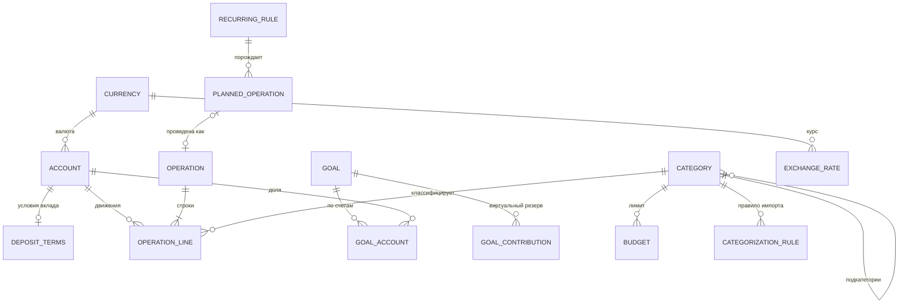

# Spendings — план разработки

> Версия 1 · 10.10.2026 · черновик для согласования
> Исследование рынка: [01-market-research.md](01-market-research.md)

## 1. Видение

Личное self-hosted веб-приложение для учёта домашних финансов **одного пользователя**:

- быстро записывать расходы и доходы по **своим** категориям и подкатегориям;
- понимать, куда уходят деньги (еда, коммуналка, топливо…) и как меняются доходы (зарплата, проценты по вкладам);
- копить на **цели** (например, новая машина) и видеть честный прогноз: сколько откладывать и когда накоплю.

### Принципы

1. **Расход с телефона вносится за 5 секунд.** Медленный ввод — главная причина, по которой учёт бросают.
2. **Данные принадлежат владельцу.** Свой сервер, без сторонних облаков и подписок, полный экспорт в любой момент.
3. **Деньги считаются точно.** `BigDecimal` / `numeric`, у каждой суммы есть валюта, никаких `double`.
4. **Просто снаружи, строго внутри.** Пользователь видит «расход / доход / перевод», внутри — операции со строками (split, переводы между валютами).
5. **Мультивалютность с первого дня.** Счета в разных валютах, отчёты в базовой валюте по курсу на дату операции.
6. **Импорт вместо синхронизации.** Синхронизация с банками — жалоба № 1 на рынке и почти недоступна в Беларуси. Ставим на быстрый ручной ввод и качественный импорт выписок.

## 2. Объём

| Приоритет | Что входит |
|---|---|
| **Must — MVP (этапы M0–M3)** | Счета и условия вкладов; свои категории и подкатегории (2 уровня); расходы, доходы, переводы, корректировки; быстрый ввод; лента с фильтрами; курсы валют и базовая валюта; дашборд и отчёты; цели с прогнозом |
| **Should — v1 (M4–M7)** | Импорт CSV/XLSX с «Входящими» и правилами; экспорт и бэкап; регулярные платежи и календарь; бюджеты план/факт; график процентов по вкладам; капитал по месяцам; PWA и passkeys |
| **Could — v2** | Telegram-бот; SMS и push банка через Android-форвардер; быстрая строка «кофе 6.5 вчера»; теги; фото чеков; автомодуль (литры, пробег, л/100 км); показания счётчиков; долги; ввод текстом через LLM |
| **Won't — пока нет** | Синхронизация с банками по API; инвестиционный портфель; семейный режим и SaaS; нативное мобильное приложение |

## 3. Ключевые сценарии

1. **Заправился.** Ярлык «Расход» на телефоне → `85,40` → Транспорт › Топливо → счёт и дата подставлены → «Сохранить». До 5 секунд.
2. **Пришла зарплата.** 5-го числа в списке «Ожидается» висит плановый доход → «Провести» с фактической суммой.
3. **Коммуналка.** Регулярный платёж 20-го, сумма каждый месяц разная → напоминание, ввод фактической суммы; отчёт показывает динамику по подкатегориям (свет, газ, вода).
4. **Отложил на машину.** Перевод с карты BYN на счёт «Машина (USD)» с конвертацией — или отметка «отложил 300 USD» без отдельного счёта. Цель показывает прогресс и прогноз даты.
5. **Открыл вклад.** 10 000 BYN, 12 % годовых, ежемесячная капитализация → график начислений и ожидаемый доход (≈ 1 268 BYN за год до налога); каждый месяц плановая операция «Проценты по вкладу».
6. **Куда ушли деньги?** Отчёт за месяц: «Еда → Продукты / Кафе», сравнение с прошлым месяцем и средним за полгода.
7. **Выписка банка.** Загружаю CSV → колонки сопоставлены по сохранённому профилю → категории проставлены правилами → подтверждаю во «Входящих».

## 4. Предметная модель

### 4.1 Счета

Типы: наличные, карта, накопительный, вклад, кредитная карта, прочее. У счёта есть валюта (после первой операции не меняется), начальный остаток и дата открытия. У вклада дополнительно хранятся условия (см. 4.5).
Остаток = начальный остаток + сумма строк операций по счёту. Он вычисляется, а не хранится.

### 4.2 Категории и подкатегории

- Два уровня: категория → подкатегория; два вида: расходы и доходы.
- Операцию можно отнести и к категории без уточнения («Еда»), и к подкатегории («Еда › Кафе»). Отчёты показывают итоги на обоих уровнях: подкатегории сворачиваются в родителя.
- Используемую категорию нельзя удалить — только **архивировать** или **объединить** с другой (операции переносятся).
- При первом запуске создаётся шаблон; его можно править как угодно.

**Шаблон категорий (редактируемый):**

| Расходы | Подкатегории |
|---|---|
| Еда | Продукты, Кафе и рестораны, Доставка |
| Жильё и коммуналка | Электроэнергия, Газ, Вода, Отопление, Интернет и ТВ, Обслуживание дома |
| Транспорт | Топливо, Парковка, ТО и ремонт, Страховка, Общественный транспорт, Такси |
| Здоровье | Аптека, Врачи, Анализы |
| Дом | Бытовая химия, Мебель и техника, Ремонт |
| Связь и подписки | Мобильная связь, Подписки |
| Одежда и обувь | — |
| Отдых и развлечения | Путешествия, Хобби, Кино и театр |
| Подарки | — |
| Образование | — |
| Финансы | Комиссии банка, Проценты по кредитам, Налоги |

| Доходы | Подкатегории |
|---|---|
| Зарплата | Аванс, Основная часть, Премия |
| Проценты по вкладам | — |
| Подработка | — |
| Кэшбэк и бонусы | — |
| Подарки | — |
| Прочие доходы | — |

### 4.3 Операции

Операция = заголовок (дата, тип, получатель, заметка, источник, статус) + строки (счёт, категория, сумма со знаком в валюте счёта).

| Тип | Строки | Пример |
|---|---|---|
| Расход | 1..n строк «−» на одном счёте, у каждой категория расходов | Чек супермаркета 87,40 BYN: Еда › Продукты −62,10; Дом › Бытовая химия −25,30 |
| Доход | 1..n строк «+» с категориями доходов | Зарплата › Основная часть +3 200 BYN |
| Перевод | 2 строки на разных счетах, без категорий, каждая в своей валюте | Карта −1 625 BYN → «Машина (USD)» +500 USD (фактический курс 3,25) |
| Корректировка | 1 строка без категории | Пересчитал наличные: −12,30 BYN |

- Переводы и корректировки не попадают в отчёты о расходах и доходах.
- Перевод с конвертацией хранит обе фактические суммы, поэтому курс банка не теряется.
- Комиссия за перевод — отдельная строка-расход с категорией «Финансы › Комиссии банка».
- Если покупка была в другой валюте (USD-покупка с BYN-карты), у строки сохраняются исходная сумма и валюта.
- Источник (`MANUAL`, `IMPORT`, `RECURRING`, `BOT`) и статус (`CLEARED`, `REVIEW`) нужны для «Входящих» после импорта.

### 4.4 Цели

Цель — это название, сумма, валюта, срок (необязателен), приоритет и картинка. Учитывать деньги на цель можно двумя способами:

- **По счетам** (по умолчанию). Деньги лежат на накопительном счёте, вкладе или в конверте с наличными, и цель привязывается к этим счетам с долей (по умолчанию 100 %).
  - Прогресс = Σ (остаток × доля) в валюте цели.
  - Взносы = поступления на привязанные счета; проценты вклада учитываются автоматически.
  - Похоже на piggy banks в Firefly III и allocations в Sure, но привязка задаётся долей, а не суммой, поэтому проценты и новые взносы распределяются сами.
- **Виртуальный резерв.** Отдельного счёта нет, деньги лежат на основной карте. «Отложил 300 USD на машину» — это отметка, а не перевод; прогресс = сумма отметок. Так работают цели в Simplifi и YNAB.

В обоих случаях деньги не считаются в капитале дважды.

- **Тип цели:** фиксированная сумма («Новая машина — 25 000 USD») или «N месяцев расходов» («Подушка безопасности — 6 месяцев»). Во втором случае сумма пересчитывается по среднему расходу за последние 12 месяцев (идея из Sure).
- **Прогноз:**
  - срок и взнос в месяц связаны: меняешь одно — пересчитывается другое;
  - дата достижения считается по среднему темпу взносов за последние 3–6 месяцев, с учётом процентов, если деньги на вкладе;
  - статус: «опережаю», «успеваю» или «отстаю на N мес.».
- **Жизненный цикл:** «Копим» → «Достигнута» → «В архиве».

> **Пример.** «Новая машина»: 25 000 USD к июню 2028, привязан вклад в USD под 3 % с ежемесячной капитализацией, накоплено 9 400 USD, средний взнос 600 USD/мес.
> Прогноз: при текущем темпе цель будет достигнута ≈ в ноябре 2028, это на 5 месяцев позже срока. Чтобы успеть, нужно ≈ 740 USD/мес (без процентов было бы 780).

### 4.5 Вклады

Вклад — это счёт типа «вклад» с условиями: банк, ставка % годовых, капитализация (нет / ежемесячно / ежеквартально / в конце срока), даты открытия и окончания, отзывной или безотзывной, автопролонгация, налог на проценты в %, счёт для выплаты процентов.

- **Условия** задаются уже в MVP (M1): они нужны для прогноза целей.
- **График начислений и ожидаемый доход** к концу срока появляются в M6.
- **Начисления** создаются как **плановые доходы** (категория «Проценты по вкладам») и подтверждаются фактической суммой из банка.
- **Расчёт:** проценты за период = остаток × ставка × дни / (365 или 366). При капитализации проценты прибавляются к остатку.
- **Налог:** в условиях вклада задаётся ставка налога, отдельно есть годовой отчёт по процентам. Правила разные: в Беларуси налог удерживает банк (для части вкладов), в России при превышении порога его платят сами до 1 декабря.

### 4.6 Валюты и курсы

- Справочник валют ISO 4217; базовая валюта задаётся в настройках (например, BYN).
- **Загрузка:** курсы берутся раз в день из API нацбанка (НБРБ `api.nbrb.by`, ЦБ РФ, ЕЦБ — провайдер подключаемый), есть ручной ввод. Храним курс к валюте провайдера, кросс-курсы вычисляем.
- **Пересчёт:** в отчётах сумма строки умножается на курс на дату операции (берётся ближайший предыдущий). Капитал считается по курсу на дату отчёта.
- **Курс приводим к 1 единице валюты:**
  - НБРБ даёт некоторые курсы за несколько единиц (RUB — за 100, поле `Cur_Scale`), а историю отдаёт окнами не длиннее 365 дней;
  - ЦБ РФ даёт курс за `Nominal` единиц, XML у него в windows-1251 с десятичной запятой;
  - готовые реализации всех трёх провайдеров есть в ezBookkeeping (MIT) — пригодятся как образец.
- **Если курса нет, курс 1 не подставляется** (на этом ошибается Firefly III). Отчёт показывает предупреждение «нет курса», а такие строки выводит отдельно.

### 4.7 Регулярные платежи и бюджеты

- **Правило** = шаблон операции + расписание: ежемесячно N-го числа (31-е → последний день месяца), еженедельно, ежегодно. Ближайшие платежи можно провести, пропустить или провести с другой суммой; авто-проведение — по флагу.
- **Зарплата** в Беларуси выплачивается минимум дважды в месяц, поэтому аванс и основная часть — два отдельных регулярных дохода.
- **Автосопоставление:** введённая вручную или импортированная операция привязывается к плановой, если сумма отличается не больше чем на N %, а дата попадает в окно −2…+7 дней. Так работают регулярные счета (bills) в Sure.
- **Бюджет** = лимит на категорию (вместе с подкатегориями) или на отдельную подкатегорию на месяц. Месяц бюджета может начинаться с любого дня, например с дня зарплаты. Есть копирование с прошлого месяца, перенос остатка по флагу, план/факт и предупреждения на 80 % и 100 %.
- **Прогноз на конец месяца:** текущий остаток + плановые доходы − плановые расходы. Плановые операции входят и в прогноз бюджета: «до конца месяца ещё коммуналка ≈ 180 BYN».

## 5. Модель данных



Эскиз ядра схемы (`V1__init.sql`, PostgreSQL 18+):

```sql
create extension if not exists pg_trgm;  -- нечёткий поиск по получателю и заметке

create table currency (
    code        char(3)  primary key,            -- ISO 4217
    name        text     not null,
    minor_units smallint not null default 2
);

create table account (
    id              uuid primary key default uuidv7(),
    name            text not null,
    type            text not null check (type in ('CASH','CARD','SAVINGS','DEPOSIT','CREDIT','OTHER')),
    currency        char(3) not null references currency,
    opening_balance numeric(19,4) not null default 0,
    opened_on       date not null default current_date,
    in_net_worth    boolean not null default true,
    sort_order      int not null default 0,
    archived_at     timestamptz,
    version         int not null default 0,
    created_at      timestamptz not null default now(),
    updated_at      timestamptz not null default now()
);

create table deposit_terms (
    account_id        uuid primary key references account on delete cascade,
    bank              text,
    annual_rate       numeric(7,4) not null,      -- 12.5000 = 12,5 % годовых
    capitalization    text not null check (capitalization in ('NONE','MONTHLY','QUARTERLY','AT_MATURITY')),
    payout_account_id uuid references account,    -- куда выплачиваются проценты без капитализации
    tax_rate          numeric(5,2) not null default 0,
    opened_on         date not null,
    matures_on        date,
    revocable         boolean not null default true,
    auto_renew        boolean not null default false
);

create table category (
    id          uuid primary key default uuidv7(),
    parent_id   uuid references category,
    kind        text not null check (kind in ('EXPENSE','INCOME')),
    name        text not null,
    icon        text,
    color       text,
    sort_order  int not null default 0,
    archived_at timestamptz,
    unique nulls not distinct (parent_id, kind, name)
);
-- глубину не больше 2 и одинаковый kind у родителя и потомка проверяет сервис

create table operation (
    id           uuid primary key default uuidv7(),
    type         text not null check (type in ('EXPENSE','INCOME','TRANSFER','ADJUSTMENT')),
    occurred_on  date not null,
    payee        text,
    note         text,
    source       text not null default 'MANUAL' check (source in ('MANUAL','IMPORT','RECURRING','BOT')),
    status       text not null default 'CLEARED' check (status in ('CLEARED','REVIEW')),  -- REVIEW = «Входящие» после импорта
    import_id    uuid,                 -- партия импорта (для отката целиком)
    external_key text unique,          -- хэш строки выписки для дедупликации
    version      int not null default 0,
    created_at   timestamptz not null default now(),
    updated_at   timestamptz not null default now()
);

create table operation_line (
    id                uuid primary key default uuidv7(),
    operation_id      uuid not null references operation on delete cascade,
    account_id        uuid not null references account,
    category_id       uuid references category,          -- null у переводов и корректировок
    amount            numeric(19,4) not null check (amount <> 0),  -- «−» списание, «+» поступление, в валюте счёта
    original_amount   numeric(19,4),                     -- сумма в валюте покупки, если она отличается от валюты счёта
    original_currency char(3) references currency,
    note              text
);

create index on operation (occurred_on desc);
create index on operation_line (operation_id);
create index on operation_line (account_id);
create index on operation_line (category_id);
create index operation_payee_trgm on operation using gin (payee gin_trgm_ops);

create table goal (
    id            uuid primary key default uuidv7(),
    name          text not null,
    kind          text not null default 'AMOUNT' check (kind in ('AMOUNT','MONTHS_OF_EXPENSES')),
    target_amount numeric(19,4) check (target_amount > 0),   -- для AMOUNT
    target_months smallint check (target_months > 0),        -- для MONTHS_OF_EXPENSES
    currency      char(3) not null references currency,
    target_date   date,
    funding       text not null default 'ACCOUNTS' check (funding in ('ACCOUNTS','MANUAL')),
    priority      int not null default 0,
    status        text not null default 'ACTIVE' check (status in ('ACTIVE','ACHIEVED','ARCHIVED')),
    icon          text,
    created_at    timestamptz not null default now(),
    achieved_at   timestamptz,
    check ((kind = 'AMOUNT' and target_amount is not null)
        or (kind = 'MONTHS_OF_EXPENSES' and target_months is not null))
);

create table goal_account (            -- funding = ACCOUNTS: где лежат деньги цели
    goal_id    uuid references goal on delete cascade,
    account_id uuid references account,
    share_pct  numeric(5,2) not null default 100 check (share_pct > 0 and share_pct <= 100),
    primary key (goal_id, account_id)
);

create table goal_contribution (       -- funding = MANUAL: виртуальный резерв
    id      uuid primary key default uuidv7(),
    goal_id uuid not null references goal on delete cascade,
    made_on date not null,
    amount  numeric(19,4) not null check (amount <> 0),       -- «−» = взял из резерва
    note    text
);

create table exchange_rate (
    rate_date date not null,
    base      char(3) not null references currency,
    quote     char(3) not null references currency,
    rate      numeric(20,10) not null check (rate > 0),       -- за 1 единицу base
    source    text not null,
    primary key (base, quote, rate_date)
);
-- recurring_rule, planned_operation, budget, categorization_rule, import_batch, app_user — на своих этапах
```

**Решения по схеме:**

- **Ключи UUIDv7:** в SQL — `default uuidv7()` (есть в PostgreSQL 18+), в JPA — `@UuidGenerator(style = VERSION_7)`. Упорядочены по времени, удобны для будущего офлайн-ввода и импорта.
- **Деньги:** `numeric(19,4)`, курсы — `numeric(20,10)`; в Java — `BigDecimal` внутри record `Money`.
- **Даты:** `occurred_on date` — дата операции без времени и часового пояса; технические метки — `timestamptz`.
- **Оптимистическая блокировка** через `version` защищает от двойной отправки формы и правки в двух вкладках.
- **Остатки не храним**, а считаем `sum()`: на десятках тысяч строк это миллисекунды. Если станет медленно — материализованное представление.
- **Отчёты пишем на SQL:** CTE, `rollup` для «категория → подкатегория», оконные функции для нарастающего остатка.
- **Никакого `ddl-auto`:** схема меняется только миграциями Flyway.

Пример отчётного запроса (расходы за период по категориям в базовой валюте):

```sql
select coalesce(c.parent_id, c.id)                          as category_id,
       c.id                                                 as subcategory_id,
       sum(-l.amount * case when a.currency = :base then 1 else r.rate end) as amount  -- нет курса → null: такие строки показываем отдельно
from operation o
join operation_line l on l.operation_id = o.id
join account a        on a.id = l.account_id
join category c       on c.id = l.category_id
left join lateral (
    select x.rate from exchange_rate x
    where x.base = a.currency and x.quote = :base and x.rate_date <= o.occurred_on
    order by x.rate_date desc
    limit 1
) r on true
where o.type = 'EXPENSE'
  and o.status = 'CLEARED'
  and o.occurred_on >= :from and o.occurred_on < :to
group by rollup (coalesce(c.parent_id, c.id), c.id);
```

## 6. Архитектура и стек

Версии проверены по официальным источникам на 10.10.2026.

| Компонент | Версия | Зачем и что важно |
|---|---|---|
| JDK | **25 LTS** (Temurin 25.0.4) | Выбрано 11.10.2026: поддержка до 2031+, все инструменты стека поддерживают 25. JDK 27 — самая свежая, но не LTS; переход — одна строка в toolchain |
| Spring Boot | **4.1.1** → 4.2.0 (ноябрь 2026) | 4.1 официально поддерживает Java 17–26; Java 27 — с 4.2 (RC1 — 22.10.2026) |
| Spring Framework | 7.0.9 → 7.1 | Web MVC, JSpecify null-safety, Jackson 3, `@Retryable` и `@ConcurrencyLimit` в ядре, HTTP-интерфейсы (`@ImportHttpServices`), версионирование API |
| Spring Security | 7.1.1 | Form login, remember-me, passkeys (WebAuthn), one-time token, MFA |
| Spring Modulith | 2.1.1 | Проверка границ модулей, события между модулями |
| Hibernate ORM | 7.4.x (в Boot — 7.4.5) | UUIDv7 через `@UuidGenerator(style = VERSION_7)` (помечено `@Incubating`) |
| PostgreSQL | **18.6** | `uuidv7()`, виртуальные генерируемые столбцы, асинхронный ввод-вывод, `WITHOUT OVERLAPS`. Версия 19 пока в бете (релиз запланирован на октябрь 2026) — обновимся после 19.1 |
| pgJDBC | **42.7.14** | Версию из Boot (42.7.13) переопределяем: в 42.7.14 закрыты две CVE |
| Flyway | 12.4.0 (версия Boot) | Нужны `spring-boot-starter-flyway` и `flyway-database-postgresql`; PostgreSQL 18 поддерживается |
| Thymeleaf | 3.1.5 | Артефакт по-прежнему `thymeleaf-spring6` |
| htmx | **2.0.11** | Стабильная линия с бессрочной поддержкой, по ней больше примеров. htmx 4.0 вышла 28.08.2026, к переходу вернёмся, когда она станет `latest` в npm (ожидается в начале 2027) |
| Alpine.js | 3.17.4 | Локальное состояние форм: split чека, калькулятор суммы |
| Apache ECharts | 6.1.0 | Sunburst, Sankey, линии и столбцы |
| Bootstrap | 5.3 | Готовая адаптивная вёрстка и тёмная тема без сборки фронтенда |
| Gradle | 9.8.1, Kotlin DSL | Java 27 поддерживается и в toolchains, и для запуска Gradle (с 9.8.0). Maven 4 всё ещё RC |
| JUnit / Testcontainers | 6.x (в Boot — 6.0.3) / 2.0.5 | В Testcontainers 2 переименованы артефакты (`testcontainers-postgresql`) и пакеты |
| springdoc-openapi | 3.1.1 | Понадобится для REST API в v2 |

В Boot 4 стартеры модульные: `spring-boot-starter-webmvc`, `spring-boot-starter-flyway` и т. д. Для тестов на каждую технологию свой `*-test`-стартер.

> **Про «самую свежую Java».** В JDK 26 и 27 нет новых **финальных** языковых возможностей по сравнению с 25 LTS: records, sealed, pattern matching, виртуальные потоки, scoped values, stream gatherers уже есть в 25. Выигрыш 27 — в рантайме: компактные заголовки объектов включены по умолчанию, G1 используется везде, в TLS есть постквантовый обмен ключами.
>
> **Решение (11.10.2026): JDK 25 LTS.** Spring Boot 4.1.1 поддерживает её официально; Gradle-демон тоже работает на 25 (`gradle/gradle-daemon-jvm.properties`), JDK скачивается автоматически через foojay.

**Инструменты на JDK 27:**

- **Lombok** не используем: есть records. Версия 1.18.46, которую подтягивает Boot, на 27 падает.
- **JaCoCo:** официальная поддержка 27 будет в 0.8.16, которая ещё не вышла; в 0.8.15 поддержка экспериментальная.
- **PMD** пока не поддерживает 27, поэтому его не берём.
- **Error Prone и google-java-format:** поддержка 27 не подтверждена. Подключаем; если что-то сломается, отключаем до выхода новых версий.
- **Локали:** в JDK 27 данные CLDR 48.2, форматы чисел и дат могут отличаться. Парсер сумм должен принимать и запятую, и точку, а пробелы — любые, включая неразрывные.
- **Память:** G1 теперь используется и в маленьких контейнерах. Для сервера задаём `-XX:MaxRAMPercentage` и лимит памяти контейнера.

### 6.1 Модульный монолит

Одно Spring Boot приложение, пакеты по функциям. Границы модулей проверяет Spring Modulith: тест `ApplicationModules.of(...).verify()` падает при циклических или «запрещённых» зависимостях.

```
com.spendings
├── SpendingsApplication
├── shared      Money, Period, ошибки, HTMX-хелперы, общий layout
├── security    единственный пользователь, вход, remember-me, passkeys
├── account     счета, условия вкладов, остатки, график процентов
├── category    дерево категорий, шаблон, архив и объединение
├── operation   расходы, доходы, переводы, строки, быстрый ввод, лента
├── fx          валюты, курсы, провайдеры (НБРБ / ЦБ РФ / ЕЦБ)
├── goal        цели, привязка к счетам, резервы, прогноз
├── importing   импорт CSV/XLSX, профили банков, «Входящие», правила
├── planning    регулярные платежи, календарь, бюджеты
└── report      дашборд и отчёты (SQL read-model)
```

Внутри модуля: `web` (контроллеры и view-модели), сервисы (`@Transactional`, публичный API модуля), `domain` (сущности, value objects), `infra` (репозитории, SQL). Всё, что не публичный API, — package-private.

**Поток запроса:** браузер (htmx) → контроллер (по заголовку `HX-Request` отдаёт целую страницу или фрагмент `th:fragment`) → сервис → JPA-репозиторий (запись) или SQL-запрос через `JdbcClient` (чтение) → PostgreSQL.

**CQRS-lite:** запись идёт через JPA-агрегаты (`Operation` вместе со строками, `Account`, `Category`, `Goal`); списки, дашборд и отчёты — через SQL-запросы в record-DTO. Так не бывает N+1 и проблем с lazy loading в шаблонах; `spring.jpa.open-in-view=false`.

**События между модулями:** `OperationRecorded` → бюджет проверяет превышение лимита, планирование сопоставляет операцию с плановой, цель проверяет достижение. Через `@ApplicationModuleListener`.

### 6.2 Современная Java в коде

```java
// shared: деньги — только BigDecimal + валюта
public record Money(BigDecimal amount, Currency currency) {
    public Money {
        Objects.requireNonNull(amount, "amount");
        Objects.requireNonNull(currency, "currency");
    }

    public Money plus(Money other) {
        if (!currency.equals(other.currency)) {
            throw new CurrencyMismatchException(this, other);
        }
        return new Money(amount.add(other.amount), currency);
    }
}

// operation: команды ввода — закрытая иерархия, switch проверяется компилятором
public sealed interface RecordOperation
        permits RecordExpense, RecordIncome, RecordTransfer, AdjustBalance {}

public record RecordExpense(UUID accountId, LocalDate date, List<Split> splits, String payee, String note)
        implements RecordOperation {}

public record RecordTransfer(UUID fromAccountId, BigDecimal fromAmount,
                             UUID toAccountId, BigDecimal toAmount, LocalDate date, String note)
        implements RecordOperation {}

Operation toOperation(RecordOperation command) {
    return switch (command) {
        case RecordExpense e  -> Operation.expense(e.date(), e.accountId(), e.splits(), e.payee(), e.note());
        case RecordIncome i   -> Operation.income(i.date(), i.accountId(), i.splits(), i.payee(), i.note());
        case RecordTransfer t -> Operation.transfer(t.date(), t.fromAccountId(), t.fromAmount(),
                                                    t.toAccountId(), t.toAmount(), t.note());
        case AdjustBalance a  -> Operation.adjustment(a.date(), a.accountId(), a.delta(), a.note());
    };
}
```

Правила: records для DTO, команд и value objects; без Lombok; `sealed` + pattern matching для типов операций; null-safety через JSpecify (`@NullMarked` на пакетах); виртуальные потоки включены (`spring.threads.virtual.enabled=true`).

## 7. Интерфейс

**Экраны:**

1. **Дашборд месяца:** остатки счетов, доходы / расходы / сальдо, норма сбережений, топ категорий и сравнение с прошлым месяцем, прогресс целей, ближайшие платежи.
2. **Быстрый ввод** (`/quick`, ярлык PWA): цифровая клавиатура для суммы → плитки категорий (частые сверху) → подкатегория → «Сохранить» или «Сохранить и ещё». Счёт и дата по умолчанию — последние использованные.
3. **Лента операций:** группировка по дням с итогом дня, фильтры (период, счёт, категория, текст), бесконечная прокрутка, правка в модальном окне.
4. **Категории:** дерево, перетаскивание для сортировки, иконка и цвет, архив, объединение.
5. **Счета:** список с остатками; карточка счёта — выписка с нарастающим остатком; у вклада — условия и график начислений.
6. **Цели:** карточки с прогрессом, прогнозом, статусом и нужным взносом в месяц; история взносов.
7. **Отчёты:** по категориям (sunburst + таблица с переходом к операциям), динамика по месяцам, доходы против расходов, денежный поток (Sankey), капитал.
8. **Входящие:** импортированные операции на проверку; подтверждение пачкой.
9. **Планирование:** регулярные платежи, календарь месяца, бюджеты план/факт.
10. **Импорт:** файл → сопоставление колонок → предпросмотр с категориями → подтверждение.
11. **Настройки:** базовая валюта, валюты, экспорт и бэкап, пароль и passkeys.

**Быстрый ввод — приёмы, проверенные рынком:**

- **Сначала сумма**, потом плитка категории: «два касания», как в Monefy.
- **Получатель запоминает категорию.** При правке приложение предлагает две вероятные альтернативы, как в Copilot.
- **Одна кнопка «+»** на каждом экране и ярлык PWA на рабочем столе телефона.
- **Подтверждение импортированного свайпом** во «Входящих», как в YNAB и Lunch Money.

**HTMX-приёмы:**

- `hx-boost` — навигация без перезагрузки страницы.
- Фрагменты Thymeleaf — частичное обновление.
- Out-of-band swap — обновление остатков после ввода.
- Заголовок `HX-Trigger` — всплывающие уведомления.
- Активный поиск: `keyup changed delay:300ms`.
- Бесконечная прокрутка: `hx-trigger="revealed"`.
- CSRF-токен передаётся в `hx-headers` из `<meta>`.
- Локальное состояние сложных форм (split чека) — на Alpine.js.

**Графики:** Apache ECharts. В нём из коробки есть sunburst (категория → подкатегория) и Sankey (доходы → расходы → сбережения).

**Вёрстка:** mobile-first, тёмная тема, крупные зоны нажатия; Bootstrap 5.3 без сборки фронтенда (статикой из `resources/static`).

## 8. Роадмап

Оценки — в рабочих днях одного разработчика при полном дне. Если работать по вечерам (10–12 ч в неделю), календарный срок вырастет в 3–4 раза.

| Этап | Результат | Дни |
|---|---|---|
| M0. Фундамент | Скелет, CI, Docker Compose, вход | 3–4 |
| M1. Ядро учёта | Счета, категории, операции, быстрый ввод — **можно начинать вести учёт** | 8–10 |
| M2. Курсы и аналитика | Курсы валют, базовая валюта, дашборд, отчёты, экспорт | 6–8 |
| M3. Цели | Цели с прогнозом — **MVP готов** | 3–4 |
| M4. Импорт | CSV/XLSX, «Входящие», правила, откат партии, бэкап JSON | 6–8 |
| M5. Планирование | Регулярные платежи, календарь, бюджеты | 5–6 |
| M6. Вклады и капитал | График процентов, капитал по месяцам, годовой отчёт | 3–4 |
| M7. Продакшн | PWA, passkeys, деплой, бэкапы, полировка — **v1** | 4–5 |
| **Итого** | MVP ≈ 20–26 дней, v1 ≈ 38–49 дней | |

Курсы валют стоят в M2, потому что без них не посчитать итоги по счетам в разных валютах и прогресс цели в USD при деньгах в BYN. Импорт стоит сразу после MVP: это главный способ не вводить карточные расходы руками.

### M0. Фундамент (3–4 дня) — ✅ готово 11.10.2026

- [x] Gradle (Kotlin DSL), version catalog `gradle/libs.versions.toml`, Java toolchain.
- [x] Spring Boot: Web MVC, Thymeleaf, Security, Data JPA, Flyway, Validation, Actuator, DevTools, Docker Compose support, Testcontainers.
- [x] `compose.yaml` с PostgreSQL; при запуске из IDE база поднимается сама (`spring-boot-docker-compose`).
- [x] Flyway `V1`: справочник валют и базовые таблицы.
- [x] Layout: шапка и навигация, Bootstrap, htmx, Alpine.js, CSRF для htmx, уведомления через `HX-Trigger`, страницы ошибок, `messages.properties` (ru).
- [x] Вход: одна учётная запись, создаётся мастером первого запуска; form login, remember-me, хэш пароля Argon2 или BCrypt.
- [x] Тесты: Testcontainers + `@ServiceConnection`, smoke-тест контекста, `ApplicationModules.verify()`.
- [x] CI (GitHub Actions): `./gradlew check`; Spotless; Renovate или Dependabot.
- **Готово, когда:** `docker compose --profile app up --build` → мастер первого запуска → вход → пустой дашборд; CI зелёный. Проверено локально; CI запустится после первого push на GitHub.

### M1. Ядро учёта (8–10 дней) — ✅ реализовано 11.10.2026, ждёт недели реального использования

- [x] Счета: CRUD, типы, валюта, начальный остаток, сортировка, архив; вычисление остатка; у вклада — условия (ставка, капитализация, сроки).
- [x] Категории: дерево из 2 уровней, CRUD, иконка и цвет, перетаскивание (SortableJS + htmx), архив, объединение с переносом операций, шаблон при первом запуске.
- [x] Операции: расход, доход, перевод (в т.ч. между валютами), корректировка остатка; split расхода по категориям; исходная сумма покупки в другой валюте; валидация через sealed-команды.
- [x] Быстрый ввод `/quick`: сумма → категория → подкатегория → сохранить; значения по умолчанию; получатель запоминает категорию; «Сохранить и ещё».
- [x] Лента: группировка по дням, фильтры, поиск, бесконечная прокрутка, правка и удаление с подтверждением в интерфейсе; автодополнение получателя (`pg_trgm`).
- **Готово, когда:** неделю веду реальные расходы только в приложении; есть тесты на остатки, переводы между валютами, split, объединение категорий.
- **Сделано иначе, чем в плане:** вместо своей цифровой клавиатуры — поле `inputmode="decimal"`, телефон показывает цифровую раскладку сам. Сверка остатка — на странице счёта: вводишь фактический остаток, разница становится корректировкой.

### M2. Курсы и аналитика (6–8 дней) — ✅ готово 11.10.2026

- [x] Курсы: таблица `exchange_rate`, провайдер НБРБ / ЦБ РФ / ЕЦБ (HTTP-интерфейс `@HttpExchange` + `@Retryable`), ежедневная загрузка по `@Scheduled`, догрузка истории, ручной курс. Курсы приводятся к 1 единице (`Cur_Scale` у НБРБ, `Nominal` у ЦБ РФ). Если курса нет, показываем предупреждение, а не считаем по курсу 1.
- [x] Базовая валюта в настройках; все итоги — в ней.
- [x] Дашборд месяца: доходы, расходы, сальдо, норма сбережений, остатки, топ категорий, сравнение с прошлым месяцем.
- [x] Отчёт по категориям: sunburst + таблица с итогами на обоих уровнях и переходом до операций; произвольный период.
- [x] Динамика за 12 месяцев: расходы и доходы, отдельная категория.
- [x] Денежный поток (Sankey): доходы → категории расходов → сбережения.
- [x] Экспорт операций в CSV и XLSX.
- **Готово, когда:** суммы в отчётах сходятся с лентой (тест на одном наборе данных); конвертация и кросс-курсы покрыты тестами.
- **Сделано иначе, чем в плане:** провайдер пока один — НБРБ (ЦБ РФ и ЕЦБ подключаются тем же интерфейсом `RateProvider`). Пересчёт в отчётах — SQL-функция `fx_rate(from, to, date)` через BYN. При первом запуске загружается история за год, дальше — с даты самой ранней операции.

### M3. Цели (3–4 дня) → MVP — ✅ готово 11.10.2026, MVP собран

- [x] Цель: сумма или «N месяцев расходов», валюта, срок, картинка, приоритет.
- [x] Два способа учёта: привязка к счетам с долей или виртуальный резерв (отметки «отложил»).
- [x] Прогресс, история взносов, прогноз: срок ↔ взнос в месяц, дата при текущем темпе с учётом процентов вклада, статус «опережаю / успеваю / отстаю».
- [x] Виджет целей на дашборде; «Копим» → «Достигнута» → «В архиве».
- **Готово, когда:** есть юнит-тесты прогноза для граничных случаев (нет срока, нулевой темп, цель уже достигнута, срок прошёл).
- **Как считается:** темп — средний взнос за последние 3 полных месяца после первого взноса (если полных ещё нет — взнос текущего месяца); ставка — средняя по вкладам с капитализацией, взвешенная по сумме; сумма «подушки» — средний расход за 12 полных месяцев × N. Один счёт можно делить между целями, но не больше 100 %. Срок ↔ взнос: калькулятор «а если откладывать X в месяц».

### M4. Импорт (6–8 дней) — ✅ готово 11.10.2026, ждёт проверки на выписке вашего банка

- [x] Мастер импорта CSV/XLSX: загрузка → сопоставление колонок (дата, сумма, знак или тип, описание, валюта) → предпросмотр → импорт. Профиль банка сохраняется и хранит кодировку (часто windows-1251), разделитель и сопоставление колонок.
- [~] «Входящие»: импортированные операции получают статус `REVIEW` и подтверждаются пачкой. Холды («заблокированные суммы» в выписках) сопоставляются с проведёнными операциями.
- [x] Дедупликация: `external_key` = хэш (счёт, дата, сумма, описание) + поиск похожих ручных операций (±1 день, та же сумма) с предложением объединить.
- [x] Откат всей партии импорта.
- [x] Правила автокатегоризации («описание содержит X → категория Y»); после ручной правки приложение предлагает создать правило.
- [x] Полный экспорт и импорт данных в JSON.
- **Готово, когда:** выписка моего банка импортируется, и ≥ 80 % строк получают категорию без ручных правок.
- **Сделано иначе, чем в плане:** холды («заблокированные суммы») не сопоставляются — формат у банков разный, вернусь к этому на реальной выписке. Вероятные дубли ручного ввода не объединяются, а пропускаются (галочка «импортировать и их»). Бэкап восстанавливается только в пустую установку. Строки импорта получают категорию «Не разобрано», если правило не нашлось.

### M5. Планирование (5–6 дней) — ✅ готово 11.10.2026

- [x] Регулярные операции: шаблон + расписание; ближайшие платежи; провести, пропустить, изменить сумму; авто-проведение по флагу.
- [x] Зарплата (аванс и основная часть) как плановые доходы; календарь платежей на месяц.
- [x] Автосопоставление введённых и импортированных операций с плановыми: допуск по сумме и окно −2…+7 дней.
- [x] Бюджеты: лимит на категорию или подкатегорию в месяц, начало месяца с любого дня (например, с дня зарплаты), копирование с прошлого месяца, перенос остатка, план/факт с учётом плановых операций, предупреждения 80 % и 100 %.
- [x] Прогноз остатка на конец месяца.
- **Готово, когда:** есть тесты расписаний (31-е число, февраль, високосный год) и план/факт.
- **Как устроено:** ожидаемые даты вычисляются из расписания, в базе хранятся только решённые исполнения (проведено со ссылкой на операцию или пропущено); удаление операции возвращает платёж в ожидаемые. Просроченными считаются платежи не старше 31 дня. Бюджеты — в базовой валюте; перенос остатка идёт по цепочке месяцев (до 24). Автопроведение — каждое утро в 6:00 и при старте.

### M6. Вклады и капитал (3–4 дня) — ✅ готово 11.10.2026

- [x] График начислений по условиям вклада, ожидаемый доход к концу срока, налог.
- [x] Плановые операции «Проценты» с подтверждением фактической суммы.
- [x] Капитал (net worth) по месяцам; доходность вкладов; годовой отчёт по процентам.
- **Готово, когда:** есть тесты расчёта процентов (с капитализацией и без, 365 и 366 дней). ✅

**Как устроено:**
- Модуль `deposit`. `InterestSchedule` — чистая функция: периоды от даты открытия (ежемесячно, ежеквартально или один период в конце срока), проценты = остаток × ставка × дни / 365 или 366 (период, переходящий через Новый год, делится по годам), налог удерживается с каждого начисления. Бессрочный вклад показывается на год вперёд.
- Прошедшие периоды считаются по фактическому остатку на начало периода (остаток счёта по дням), текущий и будущие — от сегодняшнего остатка с капитализацией.
- Ожидаемые начисления не хранятся, а вычисляются из условий; в таблице `deposit_accrual` только решения: проведено (со ссылкой на операцию) или пропущено. Удалили операцию — начисление снова ожидается. Периоды до того, как вклад завели в приложении, считаются уже вошедшими в начальный остаток.
- **Сделано иначе:** начисления — не регулярные операции из M5, а отдельный список «Пора провести проценты» на дашборде и странице вклада: сумма и даты зависят от остатка, правилу «каждый месяц N рублей» это не подходит.
- Проценты записываются доходом в категорию «Проценты по вкладам» с источником `INTEREST` — на сам вклад или, без капитализации, на счёт выплаты (новое поле в условиях вклада). В темп накопления целей такие операции не входят: рост учитывает ставка, поэтому проценты больше не считаются дважды.
- Доходность: эффективная ставка после налога с учётом капитализации и фактическая за год (полученные проценты к среднему остатку). Годовой отчёт — по вкладам и месяцам в базовой валюте, плюс сколько ещё ожидается до конца года.
- Капитал по месяцам — график за 24 месяца на странице отчётов: остатки на конец месяца по курсу на ту дату, отдельно — вклады и накопительные счета.
- Пока не сделано: автопролонгация (после даты окончания график не продолжается) и досрочное расторжение с пониженной ставкой.

### M7. Продакшн и полировка (4–5 дней) → v1 — ✅ готово 11.10.2026

- [x] PWA: manifest, иконки, service worker (кэш статики и офлайн-страница), ярлык «Быстрый расход».
- [x] Passkeys (вход по отпечатку или Face ID) через Spring Security WebAuthn.
- [x] Деплой: `compose.yaml` (приложение + PostgreSQL + бэкап), доступ через Tailscale или Caddy с HTTPS.
- [x] Бэкап: `pg_dump` каждую ночь, копия вне сервера, проверка восстановления.
- [x] Генератор тестовых данных (50 тыс. операций): дашборд открывается быстрее 300 мс.
- **Готово, когда:** восстановление из бэкапа отрепетировано; PWA устанавливается на телефон. ✅ Восстановление отрепетировано в Docker; установку проверить на своём телефоне после деплоя по HTTPS.

**Как устроено** (подробно — [03-deploy.md](03-deploy.md)):
- PWA: `manifest.webmanifest` (иконки 192/512 и maskable, ярлыки «Быстрый расход» и «Операции»), `sw.js` — статика из кэша с фоновым обновлением, страницы только из сети, без сети — `offline.html`. Данные в кэш не попадают. Проверено в headless Chrome: SW активируется и кэширует 14 файлов; при остановленном сервере показывается офлайн-страница.
- Passkeys: `http.webAuthn()` Spring Security 7 + JDBC-хранилища (миграция V9, схема из Spring Security). Свои страницы: кнопка «Войти по ключу» на входе, «Настройки → Ключи входа» (добавить, список, удалить). Домен ключей — `SPENDINGS_RP_ID`. Пароль остаётся. Сама церемония с отпечатком автоматически не проверяется — только выдача параметров и управление ключами.
- Деплой: профили compose `app` (приложение, бэкап) и `https` (Caddy с Let's Encrypt), healthcheck приложения, порт 8080 по умолчанию только на localhost, `forward-headers-strategy: native` за прокси.
- Бэкап: контейнер на образе postgres — `pg_dump` при старте и в `BACKUP_AT`, после каждого дампа — восстановление во временную базу и сверка, хранение 30 дней, `BACKUP_COPY_COMMAND` для копии вне сервера, `restore.sh` для восстановления.
- Скорость: `DemoData` (`SPENDINGS_DEMO_OPERATIONS`) и `./gradlew perfTest`. Что ускорили: капитал по месяцам (движения считаются один раз, а не на каждый месяц: 886 → 99 мс), остатки счетов (`not exists` по частичному индексу вместо join), лента — не больше 300 операций на страницу.
- **Сделано иначе:** копия вне сервера — не встроенный облачный клиент, а хук `BACKUP_COPY_COMMAND` или синхронизация каталога средствами хоста: так не нужно хранить ключи облака в приложении.

## 9. Качество

- **Юнит-тесты** доменной логики без Spring: `Money`, прогноз целей, проценты по вкладам, расписания, кросс-курсы, разбор CSV.
- **Срезы** с настоящей PostgreSQL в Testcontainers: `@DataJpaTest` и тесты SQL-отчётов; контроллеры через `MockMvcTester`, включая htmx-запросы (`HX-Request`).
- **Модули:** `@ApplicationModuleTest` и `ApplicationModules.verify()`.
- **E2E:** 3–5 сценариев на Playwright for Java (быстрый ввод, перевод между валютами, цель, импорт).
- **Статический анализ:** Spotless (форматирование), Error Prone + NullAway в режиме JSpecify — если поддерживают выбранный JDK.
- **CI:** GitHub Actions — `check`, сборка образа, сканирование уязвимостей (Trivy), Renovate.
- **Definition of Done для фичи:** тесты, миграция, тексты в `messages.properties`, проверка на ширине телефона, нет N+1, обновлены `docs/`.

## 10. Развёртывание и эксплуатация

- **Сервер:** домашний ПК, NAS или недорогой VPS. Docker Compose: `app`, `db` (PostgreSQL с томом), `backup`.
- **Образ:** `./gradlew bootBuildImage` (Buildpacks) или Dockerfile на JRE-образе; AOT-кэш JVM для быстрого старта — опционально.
- **Доступ:** лучше не публиковать в интернет. Tailscale на сервере и телефоне + `tailscale serve` даёт HTTPS-адрес (нужен для PWA и passkeys). Альтернатива — Caddy с Let's Encrypt и своим доменом.
- **Бэкапы:** ночной `pg_dump` с ротацией (7 дневных, 4 недельных, 6 месячных), копия вне сервера (rclone в облако или второй диск), раз в квартал — пробное восстановление.
- **Мониторинг:** `/actuator/health`, структурированные логи в JSON, уведомление, если бэкап не сделан.
- **Обновления:** Renovate-PR → CI → `docker compose pull && docker compose up -d`; миграции Flyway применяются при старте.

## 11. Архитектурные решения (ADR)

| # | Решение | Почему | Цена / когда пересмотреть |
|---|---|---|---|
| 1 | Серверный рендеринг: Thymeleaf + htmx | Один деплой, одна кодовая база на Java, быстрый MVP | Офлайн ограничен; для мобильного приложения добавим REST API |
| 2 | Один пользователь, без мультиарендности | Проще схема, код и безопасность | Для семьи: Hibernate `@TenantId` + миграция с `household_id` |
| 3 | Операция + строки, а не двойная запись | Split и переводы без бухгалтерской сложности | Если понадобятся долги или кредиты как полноценные счета — расширим |
| 4 | `numeric(19,4)` + `BigDecimal`, суммы в валюте счёта, курс на дату операции | Точность, история курсов не искажает прошлое | — |
| 5 | Цели: по счетам с долей или виртуальный резерв | Нет двойного учёта в капитале; прогноз учитывает проценты; можно копить без отдельного счёта | Виртуальные конверты на все деньги (YNAB) — если захочется |
| 6 | Категории: список смежности, 2 уровня, архив вместо удаления | Просто и достаточно; история не ломается | `ltree`, если понадобится больше уровней |
| 7 | JPA на запись, SQL (`JdbcClient`) на чтение | Агрегаты с инвариантами + быстрые отчёты без N+1 | jOOQ, если SQL станет много |
| 8 | UUIDv7 | Сортируемые ключи, готовность к офлайн-вводу | — |
| 9 | Flyway, SQL-миграции | Схема под контролем, повторяемость | — |
| 10 | Импорт выписок вместо синхронизации с банками | Синхронизация — жалоба № 1 на рынке и почти недоступна в Беларуси | Если появится открытый банковский API |
| 11 | Доступ только из приватной сети + вход | Финансовые данные не торчат в интернет | Публичный доступ — только с passkeys/2FA и rate limit |
| 12 | JDK 25 LTS, Boot 4.1 → 4.2 | Официальная поддержка всеми инструментами, обновления до 2031+ | Переход на 29 LTS (сентябрь 2027) или раньше — одна строка в toolchain |

## 12. Риски

| Риск | Что делаем |
|---|---|
| Инструменты отстают от новых JDK (Lombok, JaCoCo, PMD, google-java-format) | JDK 25 LTS; без Lombok и PMD; версии зафиксированы. Spotless берёт свою версию google-java-format: 1.37 через Spotless 8.10.4 падает |
| Ручной ввод надоедает, учёт бросается | Быстрый ввод ≤ 5 с, импорт выписок сразу после MVP, регулярные платежи, позже — Telegram-бот и SMS |
| Разрастание объёма | Жёсткий MVP = M0–M3, остальное по приоритетам |
| Потеря данных | Автобэкапы, копия вне сервера, отрепетированное восстановление |
| API курсов недоступно или изменилось | Кэш в БД, несколько провайдеров, ручной курс |
| Формат выписки банка меняется | Профили импорта редактируются в интерфейсе, без правки кода |
| htmx неудобен для сложных форм | Alpine.js для локального состояния (split, калькулятор суммы) |

## 13. Бэклог v2+

- **Telegram-бот** для ввода: «кофе 6.5» → расход «Еда › Кафе» 6,50 BYN (подтверждение кнопкой).
- **SMS и push от банка:** Android-форвардер (например, SmsForwarder) отправляет уведомления на `POST /api/inbox`. Разбор идёт по шаблонам банков, счёт определяется по последним 4 цифрам карты, операции попадают во «Входящие». Веб-приложение не может само читать SMS.
- **Быстрая строка** «кофе 6.5 вчера» с разбором на своём сервере, без облака.
- **Теги** поверх категорий: «Отпуск 2026», «Ремонт».
- **Фото чеков** как вложения; распознавание QR чека.
- **Автомодуль:** литры и пробег у заправок → расход л/100 км, стоимость километра, график ТО.
- **Коммуналка:** показания счётчиков и тарифы → проверка начислений.
- **Долги:** кому дал и у кого взял, напоминания.
- **Ввод текстом через LLM** (Spring AI): «заправился на 80 р, 40 литров» → операция с подкатегорией и количеством.
- **Перенос истории из Дзен-мани** через его официальный API.
- **REST API** (OpenAPI) + мобильное приложение; семейный режим.

## Источники по стеку

- JDK: https://openjdk.org/projects/jdk/27/ · https://openjdk.org/projects/jdk/25/ · https://openjdk.org/projects/jdk/28/ · https://adoptium.net/support/
- Spring: https://docs.spring.io/spring-boot/system-requirements.html · https://calendar.spring.io/ · https://github.com/spring-projects/spring-framework/wiki/Spring-Framework-Versions · https://docs.spring.io/spring-security/reference/servlet/authentication/mfa.html · https://github.com/spring-projects/spring-modulith/releases
- Hibernate: https://hibernate.org/orm/releases/
- Flyway и PostgreSQL: https://documentation.red-gate.com/fd/postgresql-database-277579325.html · https://www.postgresql.org/developer/roadmap/ · https://github.com/pgjdbc/pgjdbc/releases
- Сборка: https://docs.gradle.org/current/userguide/compatibility.html · https://maven.apache.org/docs/history.html · https://www.jooq.org/download/
- Фронтенд: https://four.htmx.org/announcements/2026-08-28-htmx-4.0.0-is-released · https://www.thymeleaf.org/
